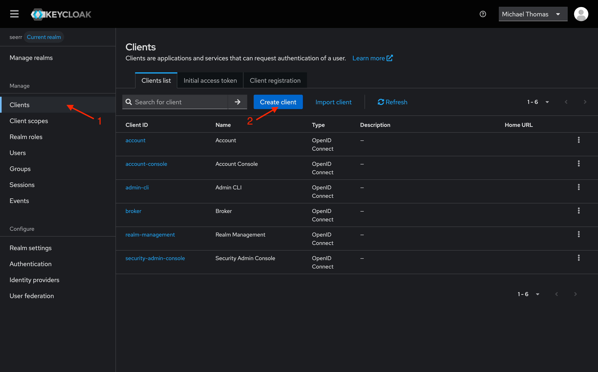
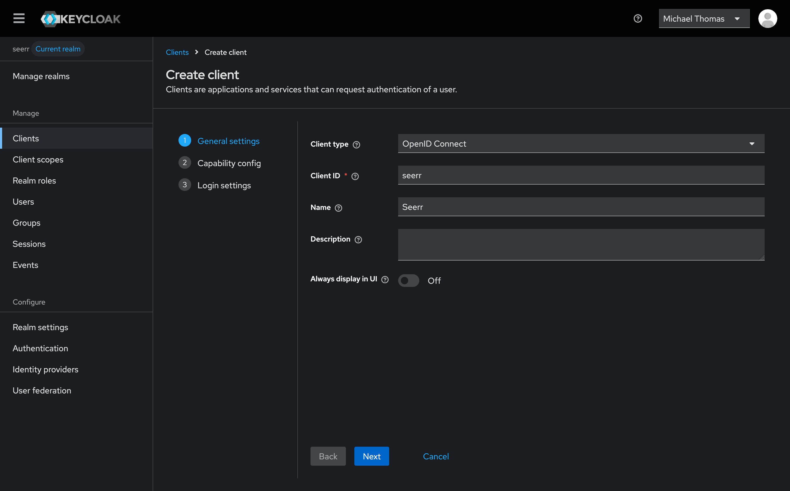
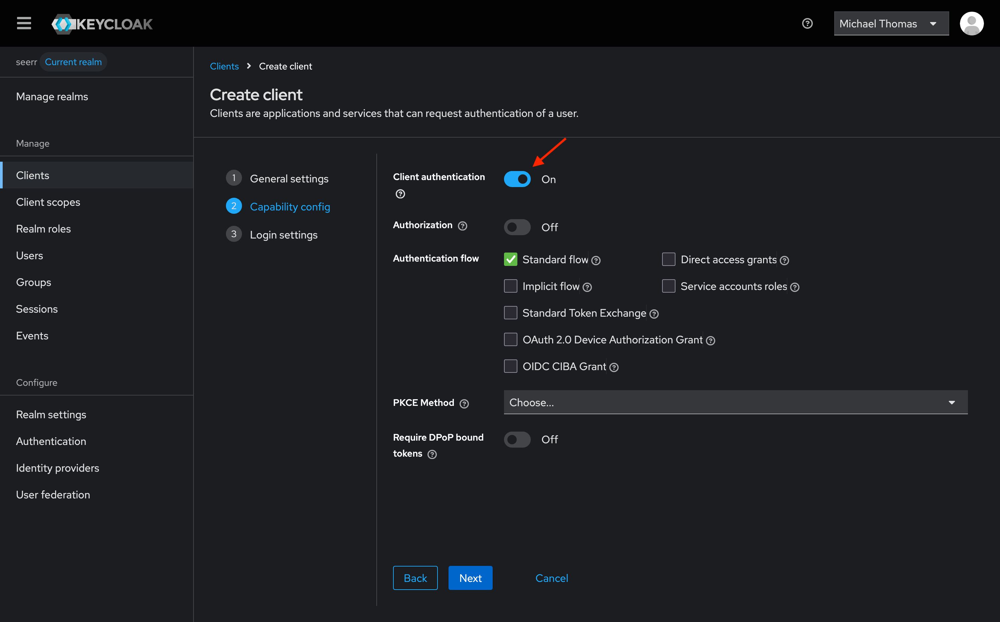
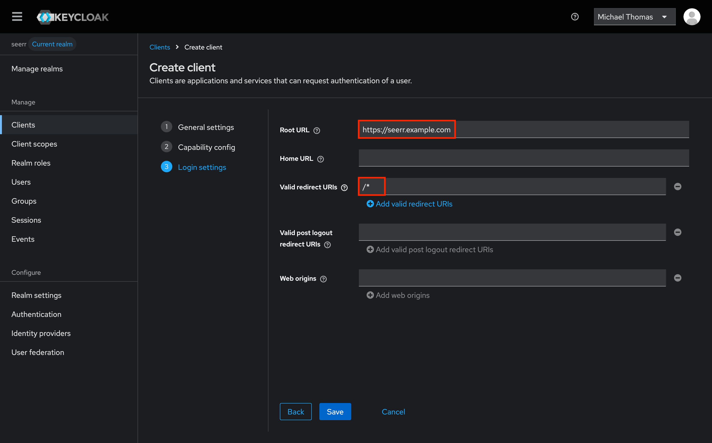
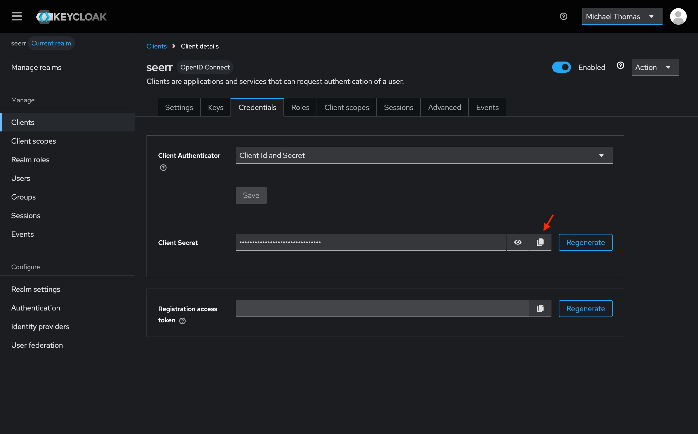

# OpenID Connect

Seerr supports OpenID Connect (OIDC) for authentication and authorization. 

:::tip

Development is ongoing for a settings interface to configure OpenID Connect support in Seerr. In the meantime, configuration must be done by manually updating the settings in `settings.json`.

:::
To begin setting up OpenID Connect, make the following updates:

```diff title="settings.json"
 {
   ...
-  "oidcLogin": false,
+  "oidcLogin": true,
   ...
   "oidc": {
-    "providers": []
+    "providers": [
+      {
+        "slug": "example",
+        "name": "Example",
+        "issuerUrl": "https://example.com",
+        "clientId": "seerr",
+        "clientSecret": "SUPER_SECRET_STRING",
+        "logo": "https://example.com/logo.png"
+      }
+    ]
   }
   ...
 }
```

## Configuration Options

### Provider Slug (`slug`)

Unique identifier for the provider. This should not be changed after initial setup. 

### Provider Name (`name`)

Name of the provider which appears on the login screen.

### Logo (`logo`)

The logo to display for the provider. Should be a URL or base64 encoded image.

### Issuer URL (`issuerUrl`)
The base URL of the identity provider's OpenID Connect endpoint

### Client ID (`clientId`)

The Client ID assigned to Seerr

### Client Secret (`clientSecret`)

The Client Secret assigned to Seerr

### Scopes (`scopes`)

Space-separated list of scopes to request from the provider

### Required Claims (`requiredClaims`)

Space-separated list of boolean claims that are required to log in

### Allow New Users (`newUserLogin`)

Create accounts for new users logging in with this provider

## Upgrading an Existing OIDC Deployment

Keep the existing provider `slug`, issuer, client credentials, and `config`
volume. Account links are identified by provider slug and OIDC subject, not by
email. The `AddLinkedAccounts1742858484395` SQLite migration is unchanged, so an
installation that has already applied it retains its existing links.

The callback URLs remain `/login` and `/profile/settings/linked-accounts`. When
`main.applicationUrl` is empty, the callback origin comes from the request. A
TLS-terminating reverse proxy must preserve the public Host and forwarded
protocol. Existing OIDC users can still sign in with `main.localLogin` disabled.

This branch also includes two extensions from notpeelz:

- `adminGroups`: an optional space-separated list of provider group names. A
  matching string in the OIDC `groups` claim grants Seerr ADMIN permission.
  With this setting absent, group claims do not change permissions. This only
  grants permissions; removing group membership does not revoke an existing
  promotion. Configure this only for groups managed by trusted administrators.
- Jellyfin linking: an OIDC user without a Jellyfin link is matched against
  Jellyfin usernames using `preferred_username`, ignoring case and surrounding
  whitespace. Existing links are preserved, accounts owned by another Seerr
  user are not reassigned, and a Jellyfin API failure does not block OIDC login.
  Only use this with an identity provider whose usernames you trust to identify
  the corresponding Jellyfin accounts.

Back up the config volume before upgrading. Test login with the existing
provider before removing the previous image. Automated tests cover proxy
callback generation and existing account preservation; they do not replace a
browser login against your identity provider.

## Provider Setup

Most OpenID Connect providers follow the same basic setup pattern:

1. **Create a new client/application** in your identity provider using the OAuth 2.0 / OpenID Connect protocol.
2. **Set the client type to confidential** (as opposed to public) so that a client secret is issued.
3. **Add redirect URIs** pointing to your Seerr instance. At minimum, allow:
   - `https://<your-seerr-url>/login`
   - `https://<your-seerr-url>/profile/settings/linked-accounts`
4. **Copy the Client ID and Client Secret** from your provider and enter them in Seerr's provider configuration.
5. **Set the Issuer URL** to the base URL of your provider's OpenID Connect discovery endpoint. Most providers publish a `/.well-known/openid-configuration` document — the Issuer URL is the part before that path.

The default scopes (`openid profile email`) are sufficient for most providers. Only adjust scopes or required claims if your provider requires it.

## Provider Guides

### Keycloak

To set up Keycloak, follow these steps:

1. First, create a new client in Keycloak.
  

1. Set the client ID to `seerr`, and set the name to "Seerr" (or whatever you prefer).
  

1. Next, be sure to enable "Client authentication" in the capabilities section. The remaining defaults should be fine. 
  

1. Finally, set the root url to your Seerr instance's URL, and a wildcard `/*` as a valid redirect URL.
  

1. With all that set up, you should be able to configure Seerr to use Keycloak for authentication. Be sure to copy the client secret from the credentials page, as shown above. The issuer URL can be obtained from the "Realm Settings" page, by copying the link titled "OpenID Endpoint Configuration".
  

1. Use `https://<keycloak-url>/realms/<realm>/` as the Issuer URL, replacing `<realm>` with your Keycloak realm name.
